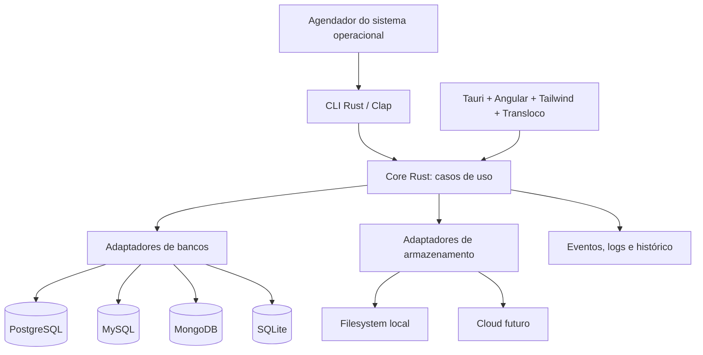
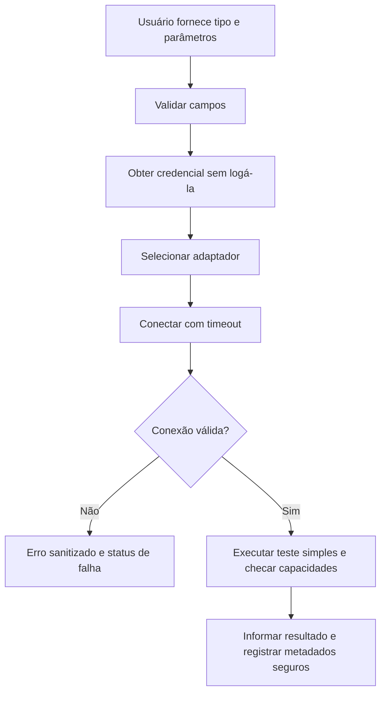
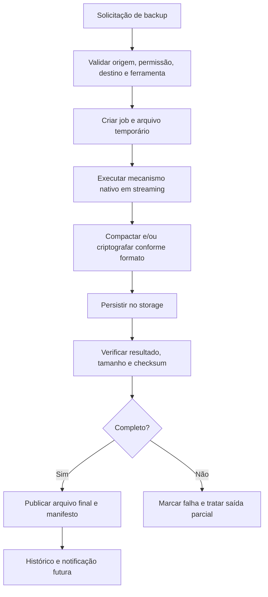
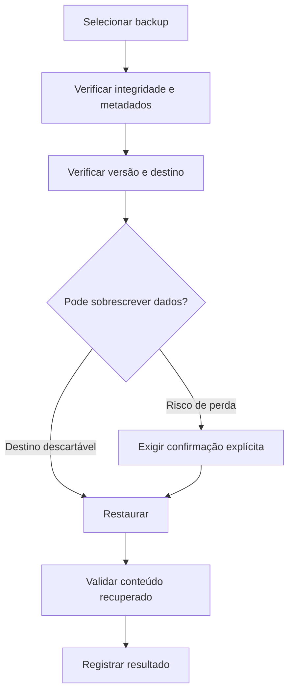

# Database Backup Utility

> Documento central de visão, decisões, escopo, arquitetura e planejamento.
>
> **Status:** v0.1.0 (CLI PostgreSQL) implementada, testada e em preparação de release. As versões seguintes (multi-SGBD, desktop, agendamento e nuvem) continuam **planejadas, não implementadas**. Na dúvida, o código e os testes são a fonte de verdade.
>
> **Repositório:** `database-backup-utility`  
> **Desafio de origem:** [roadmap.sh — Database Backup Utility](https://roadmap.sh/projects/database-backup-utility)  
> **Última revisão deste documento:** 21/10/2026

## 1. Visão geral

O **Database Backup Utility** é uma ferramenta multiplataforma para **backup, restauração e gerenciamento de backups de bancos de dados**, construída principalmente em **Rust**.

A solução terá duas formas de uso, ambas aproveitando o mesmo motor:

- **CLI em Rust:** execução manual, scripts, servidores, cron e automações de CI/CD.
- **Aplicação desktop com Tauri:** configuração visual de conexões, acompanhamento de operações, histórico, restauração e gerenciamento de agendamentos. A interface desktop será desenvolvida depois da CLI.

O objetivo não é criar um formato universal de backup do zero. Cada SGBD terá um **adaptador próprio**, aproveitando seus mecanismos oficiais quando apropriado.

### Objetivos

1. Permitir conectar-se a diferentes SGBDs com segurança.
2. Executar backups completos e restaurá-los de maneira confiável.
3. Trabalhar com bancos grandes sem carregar todo o backup em memória.
4. Oferecer armazenamento local e, posteriormente, em nuvem.
5. Possibilitar agendamento independente de uma janela desktop aberta.
6. Registrar histórico, estado, duração, resultados e falhas de operações.
7. Disponibilizar testes reproduzíveis e releases versionadas.

### Não objetivos do MVP

- Construir um SGBD próprio ou substituir `pg_dump`, `pg_restore`, `mongodump` etc.
- Prometer backup incremental, diferencial ou restauração seletiva para todos os bancos.
- Criar uma API HTTP, backend NestJS, servidor central, filas distribuídas ou agente remoto sem necessidade concreta.
- Oferecer interface Tauri na primeira versão da CLI.
- Exigir instalação de servidores PostgreSQL, MySQL e MongoDB diretamente no computador de desenvolvimento.

## 2. Registro de decisões

**Legenda:** **Confirmada** = explicitamente escolhida ao longo do planejamento; **Direção proposta** = recomendação documentada, sujeita a validação; **Em avaliação** = ainda precisa de decisão final; **Futuro** = expansão planejada, não implementada.

| ID | Decisão | Situação | Justificativa / observação |
| --- | --- | --- | --- |
| DEC-001 | Nome do repositório: `database-backup-utility` | **Confirmada** | Nome descritivo e independente do banco ou da interface. |
| DEC-002 | Monorepo com **Cargo Workspace** | **Confirmada** | Compartilhar o motor entre CLI e desktop. |
| DEC-003 | Linguagem principal **Rust** | **Confirmada** | Binários nativos, segurança de memória e streaming eficiente. |
| DEC-004 | CLI Rust como primeira interface | **Confirmada** | Cumprir primeiro o desafio original e viabilizar automações. |
| DEC-005 | Desktop futuro com **Tauri** | **Confirmada** | Aproveitar as crates Rust sem duplicar regras de negócio. |
| DEC-006 | **Angular + TypeScript** substitui React | **Confirmada** | Aplicação desktop Tauri será Angular standalone; não desenvolver frontend React. |
| DEC-007 | Utilizar **PNPM** para Angular | **Confirmada no planejamento** | Padronizar dependências, scripts e lockfile do desktop. |
| DEC-008 | Docker Compose para bancos de desenvolvimento | **Confirmada** | Evitar instalar vários servidores de banco localmente. |
| DEC-009 | Testcontainers para testes de integração Rust | **Confirmada no planejamento** | Bancos descartáveis e testes isolados do ambiente de desenvolvimento. |
| DEC-010 | SQLite sem servidor Docker | **Confirmada no planejamento** | Banco baseado em arquivo; testes com arquivos temporários. |
| DEC-011 | Arquitetura com `core` e adaptadores por SGBD | **Confirmada no planejamento** | Separar casos de uso de tecnologias específicas. |
| DEC-012 | Backups completos antes dos incrementais/diferenciais | **Confirmada no planejamento** | Funcionalidades avançadas variam por SGBD. |
| DEC-013 | `CHANGELOG.md` + SemVer + tags + GitHub Releases | **Confirmada** | Processo de publicação reproduzível. |
| DEC-014 | GitHub Actions para verificações e releases | **Confirmada** | Automatizar testes, build e publicação autorizada. |
| DEC-015 | Planejamento de versões no **Linear** | **Confirmada** | Projeto P-DB-1, milestones v0.1.0–v0.4.0, issues DB-5 a DB-34; cada milestone tem um card de release (DB-14, DB-32, DB-33, DB-34). |
| DEC-016 | `AGENTS.md` na raiz para agentes de programação | **Confirmada** | Orientar implementação, revisão, segurança e testes. |
| DEC-017 | Agendamento independente do processo Tauri | **Confirmada no planejamento** | Backup deve funcionar com a aplicação desktop fechada. |
| DEC-018 | Primeiro armazenamento local, cloud depois | **Confirmada no planejamento** | Reduzir complexidade da primeira entrega. |
| DEC-019 | Um único versionamento SemVer para o monorepo no início | **Confirmada** | Um `CHANGELOG.md`, tag e GitHub Release por versão; as releases podem começar somente com CLI. |
| DEC-020 | **Tailwind CSS v4** no Angular | **Confirmada** | Utilitários de estilo, tokens compartilhados, tema dark padrão e tema claro suportado. |
| DEC-021 | **Transloco** para i18n (`pt-BR`, `en-US`) | **Confirmada** | Português padrão, mudança dinâmica, fallback e persistência da preferência. |
| DEC-022 | Organização frontend por funcionalidades | **Confirmada** | `core/`, `shared/`, `features/`, `layout/`, `public/i18n/`; sem `libs/` extra sem compartilhamento real. |
| DEC-023 | Releases exclusivamente manuais | **Confirmada** | `release.yml` acionado somente por `workflow_dispatch` (Run workflow), na `main`; a automação valida e cria tag e GitHub Release. |
| DEC-024 | Histórico em SQLite com migrations | **Confirmada** | Esquema e estratégia de migração detalhados na DB-8; credenciais fora do banco. |
| DEC-025 | Política inicial de concorrência | **Confirmada no planejamento** | Fila, até dois backups globais e um por origem; cancelamento seguro; retomada avançada fica para o futuro. |
| DEC-026 | Ferramentas nativas e executor Docker | **Confirmada no planejamento** | Docker para desenvolvimento, runner nativo quando o cliente estiver instalado; empacotamento de distribuição continua pendente. |

**Documentos anteriores:** referências a React e a releases automáticas por push de tag pertencem a versões antigas do planejamento. A decisão vigente é **Angular + Tailwind CSS v4 + Transloco** e **release manual por `workflow_dispatch`**. Atualizar demais templates antigos quando forem adicionados ao repositório.

## 3. Escopo funcional

### 3.1 Conexões com bancos

- Cadastrar conexões identificadas por um nome amigável.
- Configurar tipo do banco, host, porta, database e usuário quando aplicável.
- Solicitar credenciais sem imprimi-las no terminal nem registrá-las nos logs.
- Validar valores e testar autenticação e uma operação simples antes do backup.
- Tratar erros de credenciais, host, timeout, permissões e incompatibilidade de ferramentas.
- Exibir capacidades suportadas pelo adaptador selecionado.

**Primeiro cenário de desenvolvimento:** PostgreSQL em `localhost:5432`, banco `my_database`, usuário `postgres`. A senha é fornecida de forma segura, não inserida no repositório.

### 3.2 Backups

- Executar **backup full**.
- Gerar identificador único por operação.
- Armazenar metadados: origem, tipo, formato, início/fim, duração, status, tamanho, checksum e destino.
- Usar leitura/escrita em **streaming** e buffers limitados.
- Suportar compactação, conforme o formato e a estratégia de cada adaptador.
- Planejar criptografia antes de persistir dados sensíveis em storage.
- Identificar arquivos parciais e não tratá-los como backups concluídos.
- Planejar política de retenção sem apagar arquivos fora das regras configuradas.

### 3.3 Restauração

- Selecionar backup existente e verificar formato, integridade e compatibilidade.
- Restaurar preferencialmente em um banco de teste ou destino separado.
- Exigir confirmação explícita antes de sobrescrever dados.
- Registrar resultado, duração e falhas.
- Validar o conteúdo restaurado em testes automatizados.
- Futuramente oferecer restauração seletiva somente onde o mecanismo do banco suportar.

### 3.4 Agendamento

- Agendar execução recorrente sem exigir que a janela Tauri esteja aberta.
- Usar inicialmente recursos do SO (por exemplo, timers/cron em Linux, Task Scheduler no Windows e launchd no macOS) para invocar a CLI.
- Evitar execuções simultâneas incompatíveis do mesmo job.
- Registrar o resultado de cada execução e permitir inspecioná-lo na CLI/desktop.
- Agente dedicado é possibilidade futura, **não decisão para o MVP**.

### 3.5 Armazenamento

- **Inicial:** diretório local configurável.
- **Posterior:** armazenamento S3 compatível (incluindo possibilidade de usar Cloudflare R2), seguido de avaliação de Google Cloud Storage e Azure Blob Storage.
- Abstrair escrita, leitura, exclusão e verificação, sem presumir que todos os providers possuem os mesmos recursos.
- Somente registrar upload como concluído quando a operação tiver sido confirmada.

### 3.6 Logs e notificações

- Registrar início, fim, duração, banco/identificador não sensível, status e erros sanitizados.
- Fornecer saída amigável na CLI e opção futura `--json` para automação.
- Planejar notificação no Slack após sucesso/falha (não é requisito da primeira entrega).
- Não registrar senhas, tokens, conteúdo do dump ou strings de conexão contendo credenciais.

## 4. Bancos e estratégias

| SGBD | Estratégia inicial | Restore inicial | Observações |
| --- | --- | --- | --- |
| PostgreSQL | `pg_dump` (formato customizado é uma opção inicial) | `pg_restore` | Validar versão das ferramentas, permissões e compatibilidade do destino. |
| MySQL | `mysqldump` | Cliente `mysql` | Validar consistência conforme engine, transações e permissões. |
| MongoDB | `mongodump` | `mongorestore` | Considerar topologia do servidor, consistência e ferramentas compatíveis. |
| SQLite | Online Backup API / mecanismo seguro de cópia | API SQLite / restauração controlada | Cuidado com banco aberto, locks e transações. |

**Capacidades por adaptador:** a matriz do que está implementado, planejado e não suportado em cada banco fica tipada em `crates/core/src/capability.rs` e documentada em [`docs/capacidades.md`](docs/capacidades.md). Incremental, diferencial, restore seletivo e recuperação point-in-time só entram como suportados quando forem **implementados e testados** para aquele banco.

Não presumir que uma opção de CLI funciona de forma idêntica em todos os bancos.

## 5. Arquitetura

### 5.1 Visão conceitual



A CLI e o Tauri são **pontos de entrada**. O `core` contém os casos de uso e contratos; adaptadores concretos implementam os contratos. O frontend apenas configura, dispara operações autorizadas e exibe o estado.

### 5.2 Estrutura prevista do monorepo

A estrutura abaixo é **alvo**, não evidência de que todas as pastas já existam. Criar módulos conforme a implementação evoluir.

```text
database-backup-utility/
├── AGENTS.md
├── README.md
├── PROJECT.md
├── CHANGELOG.md
├── Cargo.toml                    # Workspace Rust
├── Cargo.lock                    # Versionado no repositório de aplicação
├── package.json                  # Opcional: scripts de frontend no root
├── pnpm-workspace.yaml           # Se for útil ao workspace frontend
├── pnpm-lock.yaml                # Quando frontend for iniciado
├── .env.example
├── .gitignore
│
├── apps/
│   ├── cli/
│   │   ├── Cargo.toml
│   │   ├── src/
│   │   │   ├── main.rs
│   │   │   └── commands/
│   │   │       ├── connection.rs
│   │   │       ├── backup.rs
│   │   │       ├── restore.rs
│   │   │       └── schedule.rs
│   │   └── tests/              # E2E da CLI quando necessário
│   │
│   └── desktop/                 # Fase posterior
│       ├── package.json
│       ├── public/
│       │   └── i18n/
│       │       ├── pt-BR.json
│       │       └── en-US.json
│       ├── src/
│       │   ├── app/
│       │   │   ├── core/
│       │   │   │   ├── config/
│       │   │   │   ├── error-handling/
│       │   │   │   ├── i18n/
│       │   │   │   └── tauri/
│       │   │   ├── shared/
│       │   │   │   ├── ui/
│       │   │   │   ├── pipes/
│       │   │   │   └── utils/
│       │   │   ├── features/
│       │   │   │   ├── dashboard/
│       │   │   │   ├── connections/
│       │   │   │   ├── backups/
│       │   │   │   ├── restores/
│       │   │   │   ├── schedules/
│       │   │   │   ├── history/
│       │   │   │   └── settings/
│       │   │   ├── layout/
│       │   │   │   ├── app-shell/
│       │   │   │   ├── sidebar/
│       │   │   │   └── header/
│       │   │   ├── app.config.ts
│       │   │   └── app.routes.ts
│       │   └── styles.css       # Tailwind v4 e tokens do tema
│       └── src-tauri/
│           ├── Cargo.toml
│           ├── capabilities/
│           └── src/
│               ├── lib.rs
│               └── commands/
│
├── crates/
│   ├── core/
│   │   ├── Cargo.toml
│   │   └── src/
│   │       ├── backup/
│   │       ├── restore/
│   │       ├── connection/
│   │       ├── jobs/
│   │       ├── ports/
│   │       └── errors.rs
│   │
│   ├── database-adapters/
│   │   ├── Cargo.toml
│   │   ├── src/
│   │   │   ├── postgres/
│   │   │   ├── mysql/
│   │   │   ├── mongodb/
│   │   │   ├── sqlite/
│   │   │   └── runners/        # native / docker conforme necessidade
│   │   └── tests/              # Integração com SGBDs
│   │
│   ├── storage/
│   │   ├── Cargo.toml
│   │   └── src/
│   │       ├── local/
│   │       └── cloud/
│   │
│   └── scheduler/               # Criar quando houver agendamento
│       ├── Cargo.toml
│       └── src/
│
├── infra/
│   └── docker/
│       └── compose.yml
│
├── tests/
│   ├── fixtures/
│   │   ├── postgres/
│   │   ├── mysql/
│   │   ├── mongodb/
│   │   └── sqlite/
│   └── scripts/
│
├── docs/
│   ├── architecture/
│   ├── database/
│   ├── testing/
│   ├── RELEASES.md
│   └── RELEASE_PROCESS.md
│
└── .github/
    ├── workflows/
    │   ├── ci.yml
    │   ├── integration.yml
    │   └── release.yml
    └── PULL_REQUEST_TEMPLATE.md
```

### 5.3 Responsabilidades

| Diretório | Responsabilidade |
| --- | --- |
| `apps/cli` | Parsing de comandos, mensagens, códigos de saída e inicialização dos serviços. |
| `apps/desktop/src` | Interface e interação; não faz backup de banco diretamente. |
| `apps/desktop/src-tauri` | Comandos Tauri, permissões e ponte para crates Rust. |
| `crates/core` | Regras, casos de uso, modelos e contratos independentes de infraestrutura. |
| `crates/database-adapters` | Implementações concretas para conexão, backup e restore por SGBD. |
| `crates/storage` | Persistência local e futura integração cloud. |
| `crates/scheduler` | Integração de agendamento, quando houver necessidade real. |
| `infra/docker` | Bancos descartáveis ou de desenvolvimento, não dados de produção. |
| `tests` | Fixtures compartilhadas e testes E2E que abrangem mais de uma crate. |

Não criar uma crate, uma trait ou um padrão de repositório apenas por antecipação: começar com a menor separação que preserva os limites entre core e infraestrutura.

### 5.4 Organização interna do Angular

O frontend é **Angular standalone, TypeScript strict e feature-based**. O desktop será iniciado somente na milestone `v0.3.0`; o seguinte é o padrão aprovado, não pastas já implementadas.

| Diretório | Responsabilidade |
| --- | --- |
| `src/app/core/` | Infraestrutura global (configuração, i18n, bridge Tauri, tratamento de erros). |
| `src/app/shared/ui/` | UI reutilizável (botões, dialogs, loading, status badges) realmente compartilhada. |
| `src/app/shared/pipes/`, `utils/` | Transformações e funções puras entre funcionalidades. |
| `src/app/features/` | Funcionalidades isoladas; exemplos: conexões, backups, restores, schedules, history e settings. |
| `src/app/layout/` | Shell da aplicação, sidebar e header. |
| `public/i18n/` | Traduções estáticas de `pt-BR` e `en-US`. |
| `src/styles.css` | Tailwind CSS v4 e configuração de tokens globais. |
| `src-tauri/` | Comandos Rust, capabilities/permissões e integração com crates compartilhadas. |

Exemplo de organização interna de uma feature:

```text
features/backups/
├── pages/backup-list/
│   ├── backup-list.ts
│   ├── backup-list.html
│   ├── backup-list.css         # Somente se Tailwind não for suficiente
│   └── backup-list.spec.ts
├── components/backup-progress/
├── data-access/backup.service.ts
├── models/backup.model.ts
└── backups.routes.ts
```

Criar subpastas somente quando houver arquivos suficientes para justificar. Testes `*.spec.ts` ficam próximos dos arquivos testados. Não criar um pacote raiz `libs/` TypeScript até existir reutilização entre aplicações diferentes; as crates compartilhadas entre CLI e desktop são Rust em `crates/`.

**i18n:** escolher Transloco com `pt-BR` como idioma padrão e `en-US` como alternativa. Troca dinâmica sem reiniciar, fallback definido e preferência persistida em configuração local não sensível. Traduzir menus, formulários, validações, erros apresentados ao usuário, estados de backup e notificações; datas, horas e números respeitam o locale ativo. O Rust expõe códigos de erro estáveis, traduzidos pelo Angular; logs técnicos permanecem independentes das traduções de UI.

**Tailwind:** Tailwind CSS v4 será a principal forma de estilização; usar integração suportada pelo Angular CLI ou PostCSS, importar a folha Tailwind no CSS global e manter tokens semânticos. O tema escuro será o padrão, com suporte ao claro. Validar responsividade para janelas desktop e acessibilidade. Angular não necessita de SSR no runtime Tauri.

**Estado:** preferir Signals/`computed` para estado local e derivado; RxJS para streams assíncronos apropriados. Serviços Angular encapsulam comandos Tauri tipados e mocks para testes com Vitest + Angular TestBed.

## 6. Stack e ferramentas

| Camada | Tecnologia / ferramenta | Situação |
| --- | --- | --- |
| CLI | Rust, `clap` | Planejada para o MVP |
| Runtime assíncrono | `tokio` quando necessário | Proposta |
| PostgreSQL | `tokio-postgres` para teste de conexão; `pg_dump`/`pg_restore` para backup/restore | Proposta |
| Erros | `thiserror`; `anyhow` no limite da aplicação, se útil | Proposta |
| Logs | `tracing` | Proposta |
| Serialização | `serde` / `serde_json` | Proposta |
| Compactação | `zstd`, conforme compatibilidade com formato | Proposta |
| Criptografia | Biblioteca madura a selecionar; `age` é candidata | Em avaliação |
| Cloud | S3 compatível inicialmente; avaliar `object_store` | Futuro |
| Desktop | Tauri | Confirmada para fase futura |
| Frontend desktop | **Angular standalone + TypeScript strict + Tailwind CSS v4** | **Confirmada**, implementação planejada para v0.3.0 |
| Testes Rust | `cargo test`, Testcontainers | Confirmados no planejamento |
| Testes Angular | Vitest + Angular TestBed | **Confirmados no planejamento** |
| i18n desktop | Transloco (`pt-BR`, `en-US`) | **Confirmada**, com persistência e mudança em tempo de execução |
| Infra de desenvolvimento | Docker Compose | Confirmada |
| CI/CD | GitHub Actions | Confirmada |
| Releases | SemVer, Keep a Changelog, Git tags | Confirmada |
| Gestão do trabalho | Linear | **Confirmada**, projeto `P-DB-1` e cards `DB-5` a `DB-16` |

## 7. Uso de Docker

### 7.1 Desenvolvimento

- Usar Docker Compose para **PostgreSQL, MySQL e MongoDB**.
- Subir somente o serviço necessário; usar profiles para bancos que não precisam estar sempre ativos.
- Expor as portas de desenvolvimento apenas em `127.0.0.1`, quando o acesso for local.
- Persistir os dados de desenvolvimento em volumes nomeados.
- Não versionar `.env` nem dumps reais; manter `.env.example` com valores de demonstração.
- SQLite usa arquivo local e não necessita de servidor/container próprio.

### 7.2 Como executar ferramentas de dump

O servidor em Docker **não implica** que `pg_dump` esteja instalado no host. O sistema deve isolar a estratégia de execução:

- **Modo nativo:** executar `pg_dump`/`pg_restore` instalados ou distribuídos de forma compatível com o sistema.
- **Modo containerizado:** executar o cliente apropriado em um container, quando Docker estiver disponível e configurado.

A decisão final de empacotamento de ferramentas por sistema operacional será feita antes da distribuição pública. Evitar executar comandos interpolando strings em um shell; passar argumentos estruturados e credenciais por mecanismos seguros compatíveis com cada ferramenta.

### 7.3 Testes com Docker

Os testes de integração **não devem reaproveitar o banco de desenvolvimento**. Testcontainers inicia bancos descartáveis com portas dinâmicas e dados isolados, inclusive para testar backup e restauração.

## 8. Fluxos principais

### 8.1 Cadastro e teste de conexão



**Critérios de aceite iniciais:** conexão válida retorna sucesso; senha errada, banco inexistente, timeout e servidor indisponível retornam erros controlados; nenhuma credencial aparece em stdout, stderr ou logs.

### 8.2 Backup full



**Cuidados:** limitar memória; usar backpressure; checar códigos de saída; lidar com cancelamento; distinguir backup incompleto de backup válido; documentar consistência do snapshot do SGBD.

### 8.3 Restauração



**Critérios de aceite:** restaurar com sucesso um backup em banco separado e verificar dados (por exemplo, contagem e registros esperados), não somente um código de saída igual a zero.

### 8.4 Agendamento independente do desktop

```text
Agendador do sistema operacional
               |
               v
        CLI database-backup
               |
               v
         Motor Rust compartilhado
               |
               v
       Histórico / logs / storage
               |
               v
      Desktop consulta o resultado
```

Não depender de uma janela Tauri aberta. Configurações e registros persistentes devem estar disponíveis para o processo agendado de acordo com as permissões do usuário/serviço.

## 9. CLI (implementada na v0.1.0)

Sintaxe atual. Referência completa em `docs/comandos.md` e no `--help` de cada comando:

```bash
database-backup connection test --database app --user backup
database-backup backup run --database app --user backup [--output-dir DIR] [--runner auto|native|docker]
database-backup backup list [--database app] [--json]
database-backup backup verify --file app-20261021T120000Z.dump
database-backup restore run --file app-20261021T120000Z.dump --target-database app_staging --user backup
database-backup restore list
```

A senha nunca é aceita por argumento. Ela vem de um prompt sem eco, de `DBU_PG_PASSWORD` ou de um
arquivo `600` (`--password-file`/`DBU_PG_PASSWORD_FILE`), e só uma fonte pode estar definida.
`--json` está disponível em todos os comandos.

Ainda **não** existem (planejado): conexões cadastradas por nome, `--type` incremental/diferencial,
`--storage` de nuvem e restore por ID de backup.

## 10. Dados internos e metadados (planejamento)

**Decisão confirmada:** utilizar **SQLite interno com migrations SQL versionadas** para registrar configurações não sensíveis e histórico local, sem introduzir outro serviço. O esquema abaixo permanece proposto e deverá ser validado durante a issue DB-8; ainda não existe no código.

Entidades conceituais, ainda **não modeladas no código**:

| Entidade | Campos relevantes |
| --- | --- |
| `connections` | id, nome, SGBD, host/arquivo, porta, database, usuário, referência ao segredo (nunca senha pura) |
| `backup_jobs` | id, conexão, tipo, início, fim, status, duração, mensagem de erro sanitizada |
| `backup_artifacts` | id, job, formato, caminho/chave, tamanho, checksum, compressão, criptografia, versão da ferramenta |
| `schedules` | id, conexão, expressão/intervalo, destino, habilitado, última execução |
| `restore_jobs` | id, backup, destino, início, fim, status, resultado de validação |

Nunca guardar senhas dentro do SQLite de metadados. Usar uma interface de segredos Rust para CLI, desktop e agendamentos; adaptar a fonte de segredo ao ambiente (prompt, keyring/cofre do SO, arquivo secreto protegido ou gerenciador externo para execução não interativa). A biblioteca e a política concreta de provisionamento ainda precisam ser implementadas e validadas.

## 11. Segurança e confiabilidade

1. **Segredos:** não hardcodar, imprimir, serializar ou enviar credenciais a logs; `.env` é apenas conveniência em ambiente descartável e não substitui um cofre de segredos.
2. **Conexões:** exigir TLS com validação apropriada quando houver tráfego remoto/sensível; `NoTls` só é aceitável para cenários locais de desenvolvimento explicitamente controlados.
3. **Execução de processos:** usar argumentos estruturados, evitar shell injection, aplicar timeout e checar o código final.
4. **Backups em repouso:** planejar criptografia autenticada e armazenamento seguro das chaves; sem a chave, dados criptografados não podem ser restaurados.
5. **Arquivos:** usar caminhos controlados, permissões restritivas, nomes seguros, gravação temporária e conclusão atômica quando possível.
6. **Integridade:** armazenar checksum e metadados; conferir antes de restaurar; testar restore periodicamente.
7. **Restauração destrutiva:** evitar sobrescrita automática, informar claramente origem e destino, exigir confirmação explícita.
8. **Retenção:** nunca apagar dados fora da política; testar regras de exclusão com simulação/dry-run quando for implementada.
9. **Logs:** registrar somente dados operacionais necessários e sanitizar erros potencialmente sensíveis.
10. **Recursos:** fila inicial de até **2 jobs globais**, no máximo **1 por banco de origem**, com cancelamento seguro e buffers limitados; limites específicos de I/O e retomada de dumps interrompidos são funcionalidades posteriores.
11. **Falhas:** nunca apresentar upload parcial ou saída incompleta como sucesso; manter estados explícitos e arquivos recuperáveis/limpáveis.
12. **Distribuição:** verificar versões de ferramentas externas e compatibilidade com o SGBD; não assumir portabilidade de dependências nativas sem teste.

## 12. Estratégia de testes

### 12.1 Pirâmide de testes

| Tipo | Local | Ferramentas | O que valida |
| --- | --- | --- | --- |
| Unitário Rust | Módulos `src` com `#[cfg(test)]` | `cargo test` | Regras, validações, estados e erros. |
| Integração Rust | `crates/*/tests/` | Cargo + Testcontainers | Conexões e operações reais em SGBDs descartáveis. |
| E2E CLI | `apps/cli/tests/` ou `tests/e2e/` | Testes de processo + Docker | Comandos, códigos de saída, arquivos e restauração. |
| Componente Angular | Ao lado dos componentes `*.spec.ts` | Angular TestBed + Vitest | Formulários, estados, validação, bridge Tauri mockada e i18n (`pt-BR`, `en-US`, persistência/fallback). |
| Integração Tauri/Desktop | Fase futura | Harness apropriado | Ponte JS-Rust e operações críticas, quando implementadas. |

### 12.2 Casos essenciais do MVP PostgreSQL

- Parâmetros válidos e inválidos.
- Conexão autenticada corretamente.
- Credencial incorreta; banco inexistente; timeout; servidor indisponível.
- Execução de backup completo e produção de arquivo legível.
- Restore em base descartável e **comparação de dados**.
- Falha do utilitário `pg_dump` e propagação controlada do erro.
- Arquivo parcial/corrompido recusado ou marcado como falha.
- Senhas ausentes de mensagens de erro, logs e resultados.
- Uso de nomes e caminhos de arquivo seguros.

### 12.3 Práticas

- Testes unitários não devem exigir Docker.
- Os de integração criam dados próprios e não dependem de volume persistente da equipe.
- Preferir fixtures pequenas e determinísticas.
- Separar testes que exigem binários `pg_dump`/`pg_restore` ou imagens Docker específicas e registrar pré-requisitos.
- Não apagar volumes ou arquivos de desenvolvimento durante teardown de testes.
- Testar falhas e caminhos de recuperação, não apenas fluxo feliz.

### 12.4 Comandos de verificação (quando o workspace existir)

```bash
cargo fmt --all -- --check
cargo clippy --workspace --all-targets -- -D warnings
cargo test --workspace
cargo check --workspace
```

Para o desktop Angular, após a criação da aplicação, usar os scripts **efetivamente configurados** no `package.json` para lint, testes Vitest e build; não assumir comandos inexistentes.

## 13. CI/CD e controle de qualidade

### Pull requests

- `cargo fmt` / Clippy.
- Testes unitários.
- Testes de integração com Docker/Testcontainers quando executáveis no runner.
- Build/checagem da CLI.
- Na v0.3.0: lint, tipagem estrita, testes Vitest/Angular (inclusive i18n), build Angular e verificações Tauri conforme plataformas suportadas.
- Revisão focada e sem mudanças alheias ao escopo.
- Pull Requests para `main`, **Squash & Merge** e checks obrigatórios; sem branch `develop` obrigatória.

### Releases

- Versionamento **Semantic Versioning**; tags `vMAJOR.MINOR.PATCH`.
- `CHANGELOG.md` em **Keep a Changelog**, com seção `Unreleased`.
- Somente funcionalidades **implementadas e verificadas** entram no changelog.
- `docs/RELEASES.md` documenta planos e **não** declara entregas efetivas.
- **Publicação exclusivamente manual**: GitHub Actions → Release → **Run workflow** (`workflow_dispatch`), selecionando `main` e informando `vX.Y.Z`.
- Após verificar versão, changelog e checks, o workflow compila, calcula checksums, cria a tag e a GitHub Release com binários e notas.
- O workflow de Release **não** deve possuir gatilho de push de tag nem publicação automática em merges; a CI de PR e `main` permanece automática.
- Artefatos iniciais previstos para CLI Linux x86_64; distribuição Windows/macOS e instaladores Tauri após validação técnica.
- Incluir checksums e notas derivadas do changelog.
- Nunca publicar dumps de banco, credenciais, `.env` ou logs com dados sensíveis como artefatos.
- Não criar tags nem publicar versões automaticamente apenas porque uma tarefa foi concluída.

**Atenção à migração de estrutura:** um workflow inicial pode assumir `Cargo.toml`/binário na raiz; ao usar `apps/cli` dentro do Cargo Workspace, ajustar os paths, o nome do pacote e as opções `--package` conforme o projeto real.

## 14. Roadmap e releases planejadas

> A v0.1.0 está implementada (milestone "v0.1.0 — PostgreSQL CLI" no Linear, DB-5 a DB-19). As demais versões são **propostas de escopo futuro** e não indicam releases publicadas. A v1.0.0 e a v2.0.0 ainda não têm milestone nem cards no Linear.

### v0.1.0 — Core Rust + PostgreSQL CLI

- [x] Criar Cargo Workspace e CLI com `clap`.
- [x] Implementar parâmetros e teste seguro de conexão PostgreSQL.
- [x] Executar `pg_dump` em fluxo controlado, com saída em arquivo local.
- [x] Restaurar com `pg_restore` em base separada.
- [x] Implementar logs, status e registro mínimo da operação.
- [x] Criar testes unitários e de integração com Testcontainers.
- [x] Configurar CI, changelog e processo de release.
- [x] Documentar comandos e pré-requisitos.

### v0.2.0 — Multi-database

- [ ] Adicionar SQLite.
- [ ] Adicionar MySQL.
- [ ] Adicionar MongoDB.
- [ ] Definir capacidades suportadas por adaptador.
- [ ] Testar backup e restore reais em ambientes isolados.

### v0.3.0 — Desktop Tauri + Angular

- [ ] Inicializar Angular standalone, TypeScript strict, PNPM e Tauri.
- [ ] Configurar Tailwind CSS v4, tokens semânticos, dark mode padrão e suporte a tema claro.
- [ ] Configurar Transloco, `pt-BR` e `en-US`, troca dinâmica, fallback e persistência da preferência.
- [ ] Adotar arquitetura `core/`, `shared/`, `features/`, `layout/` e `public/i18n/`.
- [ ] Implementar telas de conexões, backup, restore, histórico e configurações.
- [ ] Integrar comandos Tauri ao motor Rust da CLI, sem duplicar regras.
- [ ] Aplicar validações, acessibilidade e confirmação em operações destrutivas.
- [ ] Criar testes Vitest/Angular TestBed de componentes, estados e idiomas; verificar integração da ponte Tauri.

### v0.4.0 — Agendamento, armazenamento e proteção

- [ ] Integrar agendadores do sistema operacional.
- [ ] Adicionar storage S3 compatível.
- [ ] Permitir compressão configurável sem comprometer compatibilidade do dump.
- [ ] Adicionar criptografia de arquivos e gerenciamento seguro de chaves.
- [ ] Implementar retenção e notificações Slack.

### v1.0.0 — Estabilidade e distribuição

- [ ] Validar restaurações e integridade de ponta a ponta.
- [ ] Cobrir falhas importantes e requisitos de segurança.
- [ ] Validar Windows, Linux e macOS.
- [ ] Produzir binários, instaladores e documentação de operação.

### v2.0.0 — Funcionalidades avançadas (possíveis)

- [ ] Incremental/diferencial onde realmente houver suporte.
- [ ] Recuperação point-in-time nos bancos e cenários compatíveis.
- [ ] Agente remoto opcional, se existir demanda comprovada.

## 15. Critérios de conclusão da primeira entrega

A `v0.1.0` só deverá ser considerada pronta quando (situação em 21/10/2026, com a evidência de cada item):

1. ✅ Um usuário conseguir executar `--help` e configurar uma conexão PostgreSQL local. Evidência: `apps/cli/tests/cli.rs`, README.
2. ✅ A conexão puder ser validada sem expor senha. Evidência: `test_connection.rs`, varredura de segredos no E2E.
3. ✅ Um backup completo produzir um artefato íntegro e identificado. Evidência: SHA-256 + manifesto versionado (`docs/manifesto.md`).
4. ✅ O backup puder ser restaurado em um PostgreSQL descartável. Evidência: E2E `full_cycle_restores_identical_data_on_another_server`.
5. ✅ O teste de restore comparar dados esperados, em vez de apenas confiar no exit code. Evidência: snapshot de schema e hash das linhas no E2E.
6. ✅ Os cenários de falha essenciais forem cobertos e documentados. Evidência: `docs/testes.md`, `docs/seguranca.md`.
7. ✅ Os comandos de formatação, análise estática e testes definidos para a release passarem. Evidência: CI verde na `main`; validação local do DB-14.
8. ✅ O README, o changelog e o processo de release refletirem exatamente o que existe no código. Evidência: revisão do DB-14.

## 16. Convenções para desenvolvimento assistido por IA

O arquivo [`AGENTS.md`](AGENTS.md) da raiz é a referência operacional para agentes de programação. Em resumo:

- Analisar código e testes existentes **antes** de alterar algo.
- Definir objetivo e critérios de aceite para tarefas não triviais.
- Implementar somente o necessário, sem refatorações não solicitadas.
- Usar Rust idiomático, `Result`, erros tipados e logs estruturados.
- Evitar `unwrap()` em execução de produção e `unsafe` desnecessário.
- Preferir streaming a carregar backups inteiros na memória.
- Tratar segurança das credenciais e risco de perda de dados como requisitos centrais.
- Criar testes focados e **informar o que de fato foi executado**.
- Não alterar versões, criar tags ou publicar releases sem autorização.
- Registrar no `CHANGELOG.md` somente alterações efetivamente verificadas.

## 17. Decisões pendentes e limites definidos

**Já decidido:** Angular em vez de React, Tailwind CSS v4, Transloco (`pt-BR`/`en-US`), monorepo, SQLite interno com migrations, política inicial de 2 jobs/1 por origem, versionamento unificado e **releases apenas via Run workflow**. Não reabrir essas escolhas sem solicitação explícita.

**Detalhes ainda a projetar e validar na implementação:**

1. **Empacotamento para usuários finais:** cliente externo, binário por SO ou executor Docker opcional; compatibilidade e licenças por SGBD.
2. **Esquema e migrations SQLite:** colunas, índices, integridade referencial e atualização segura; issue DB-8.
3. **Segredos:** tecnologia concreta e operação do scheduler não interativo com cofre bloqueado.
4. **Compressão e criptografia:** formato por SGBD, ferramenta de chaves, rotação, exportação e restauração.
5. **Concorrência:** limites finos de I/O, comportamento ao cancelar, fairness de fila e eventual retomada de upload; sem prometer retomada de dump.
6. **Incremental/diferencial/PITR:** capacidades específicas e testadas por SGBD, sem suporte universal fictício.
7. **Distribuição multiplataforma:** binários auxiliares, assinatura, instaladores e testes de Windows/macOS.
8. **Ciclos de lançamento diferentes:** manter versões unificadas por enquanto e reavaliar somente se houver necessidade real de publicar CLI e desktop separadamente.

## 18. Documentos relacionados

| Documento | Finalidade |
| --- | --- |
| [`README.md`](README.md) | Apresentação pública, instalação e primeiros comandos conforme forem implementados. |
| [`docs/uso.md`](docs/uso.md) | Manual da CLI: requisitos por SGBD, backup, verificação, restore e exit codes. |
| [`AGENTS.md`](AGENTS.md) | Instruções para agentes de código e contribuidores. |
| [`CHANGELOG.md`](CHANGELOG.md) | Mudanças implementadas e verificadas. |
| [`docs/RELEASES.md`](docs/RELEASES.md) | Roadmap de versões, ainda que não publicadas. |
| [`docs/RELEASE_PROCESS.md`](docs/RELEASE_PROCESS.md) | Checklist e procedimento de Git tags/GitHub Releases. |
| `docs/architecture/` | Diagramas, decisões arquiteturais (ADRs) e trade-offs quando necessários. |
| `docs/testing/` | Como executar e escrever testes e preparar Docker. |

### Referências externas

- [Desafio do projeto no roadmap.sh](https://roadmap.sh/projects/database-backup-utility)
- [Artigo do Akita sobre projetos open source, LLM e boas práticas](https://akitaonrails.com/2026/05/30/boas-praticas-projetos-codigo-aberto-llm-o-minimo/)
- [Cargo Workspaces](https://doc.rust-lang.org/cargo/reference/workspaces.html)
- [Rust API Guidelines](https://rust-lang.github.io/api-guidelines/)
- [Tauri](https://tauri.app/)
- [Angular](https://angular.dev/)
- [Guia de estilo Angular](https://angular.dev/style-guide)
- [Tailwind CSS para Angular](https://angular.dev/guide/tailwind)
- [Transloco](https://jsverse.github.io/transloco/)
- [Testcontainers para Rust](https://docs.rs/testcontainers/)
- [Keep a Changelog](https://keepachangelog.com/)
- [Semantic Versioning](https://semver.org/)

---

> **Regra de manutenção:** atualizar este documento quando uma decisão relevante for formalizada ou alterada. Atualizar o `CHANGELOG.md` somente quando a implementação real tiver sido concluída e verificada. Planejamento, documentação e funcionalidades implementadas são estados distintos.
