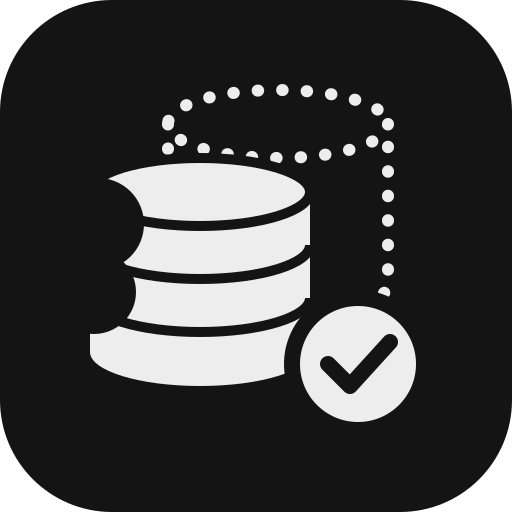
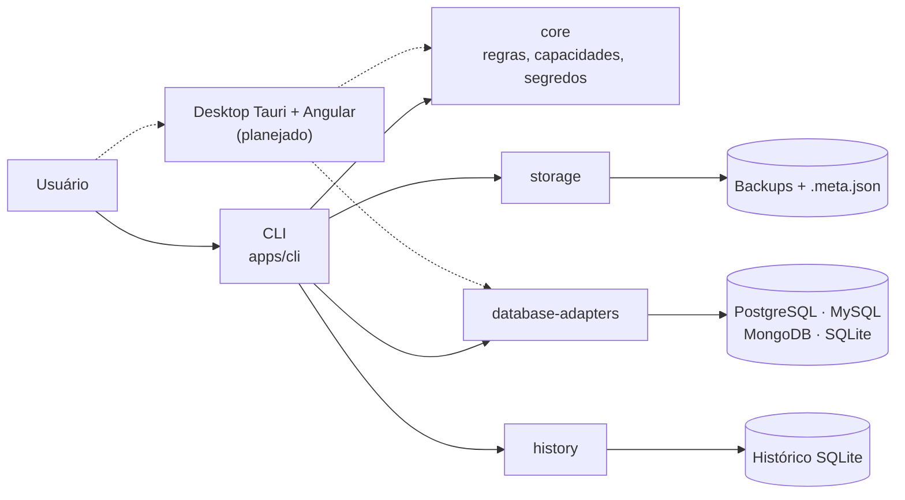

<div align="center">
  

  # Database Backup Utility

  CLI em Rust para backup, verificação e restauração de PostgreSQL, MySQL, MongoDB e SQLite, com um
  app desktop Tauri + Angular planejado sobre as mesmas crates.
</div>

## Sobre

A CLI `dbu` gera backups completos com as ferramentas oficiais de cada banco (instaladas
ou via Docker) ou, no SQLite, com a Online Backup API. Cada arquivo é gravado de forma atômica, com
SHA-256 e um manifesto versionado ao lado, e o restore sempre confere o backup antes de tocar no
destino. O futuro app desktop vai usar as mesmas crates Rust, sem regra de backup no frontend.

**Tecnologias:** CLI `Rust / Clap / Tokio` · Bancos `PostgreSQL / MySQL / MongoDB / SQLite` ·
Histórico `SQLite` · Desktop (planejado) `Tauri / Angular / Tailwind v4` · Workspace `Cargo`

> **Estado atual (v0.1.1 + `Unreleased`):** a v0.1.1 publicada cobre só o PostgreSQL. SQLite, MySQL e
> MongoDB, além do comando `engines`, estão na `main` e entram na v0.2.0. **Ainda não existem:**
> desktop, sobrescrita no restore MySQL e MongoDB, backup MongoDB do servidor inteiro com `--oplog`,
> agendamento, nuvem, compressão extra e criptografia (ver [`docs/RELEASES.md`](docs/RELEASES.md)).

## Arquitetura



| Componente | Responsabilidade | Detalhes |
| --- | --- | --- |
| `apps/cli` | Comandos, saída texto/JSON, exit codes e fluxo de cada SGBD | [Organização da CLI](docs/arquitetura.md#organização-da-cli) |
| `crates/core` | `DatabaseEngine`, matriz de capacidades, configurações de conexão e segredos | [Capacidades](docs/capacidades.md) |
| `crates/database-adapters` | Conexão, `pg_dump`/`mysqldump`/`mongodump` e restores, Backup API do SQLite | [Arquitetura](docs/arquitetura.md) |
| `crates/storage` | Arquivo `.partial`, SHA-256, `rename` atômico e manifesto | [Manifesto](docs/manifesto.md) |
| `crates/history` | Histórico interno de backups e restores com migrations | [Modelo de dados](docs/diagramas/modelo-de-dados.md) |
| `apps/desktop` | App Tauri + Angular (planejado para a v0.3.0) | [Releases](docs/RELEASES.md) |

## Demonstração

Backup, verificação e restore de um SQLite com o binário de release. O último comando mostra que um
restore nunca sobrescreve um arquivo sem `--overwrite`:

```console
$ dbu backup -e sqlite --source ./app.db -o ./backups
Backup concluído: ./backups/app-20261028T145750Z.sqlite3 (12.0 KB, sha256 e78319eead0e…) em 0.0s

$ dbu verify backups/app-20261028T145750Z.sqlite3
Backup SQLite válido: ~/demo/backups/app-20261028T145750Z.sqlite3 (2 objetos, 2 tabelas; checksum conferido; sha256 e78319eead0e…)
Manifesto v2: sqlite app.db, criado em 2026-10-28T14:57:50.06333711Z por database-backup 0.1.1

$ dbu restore -e sqlite backups/app-20261028T145750Z.sqlite3 --to ./app_copia.db
Restore concluído em ~/demo/app_copia.db (2 objetos) em 0.0s

$ dbu restore -e sqlite backups/app-20261028T145750Z.sqlite3 --to ./app.db
Erro: o arquivo ~/demo/app.db já existe; use --overwrite para substituí-lo (o atual será mantido como ~/demo/app.db.previous-<data>)
```

## Comandos principais

| Comando | O que faz |
| --- | --- |
| `dbu backup -d app -u backup` | Gera um backup completo com checksum e manifesto (`-e mysql`, `-e mongodb`, `-e sqlite --source ./app.db`) |
| `dbu verify <ARQUIVO>` | Confere checksum e estrutura de um backup, sem restaurar |
| `dbu restore <ARQUIVO> --to <DESTINO>` | Restaura um backup conferido em um destino novo (ou com `--overwrite`, onde suportado) |
| `dbu list` / `dbu list restores` | Lista os backups ou as restaurações do histórico |
| `dbu test -d app -u backup` | Valida os parâmetros e testa a conexão (PostgreSQL, MySQL, MongoDB) |
| `dbu engines` | Mostra o que cada SGBD suporta, planeja ou não suporta |

Flags curtas: `-e` SGBD, `-H` host, `-p` porta, `-d` banco, `-u` usuário, `-f` arquivo, `-o` pasta de saída.
Os comandos longos continuam valendo (`backup run`, `backup verify`, `restore run`, `connection test`),
e o tarball também traz `database-backup` como atalho para `dbu`.

> Opções, exemplos por SGBD e exit codes estão em [Uso da CLI](docs/uso.md). Todo comando aceita
> `--json` e `--help`.

## Como executar

Binário para Linux x86_64 nos [GitHub Releases](https://github.com/aqu1no1/database-backup-utility/releases):

```bash
VERSION=v0.1.1
curl -LO "https://github.com/aqu1no1/database-backup-utility/releases/download/$VERSION/database-backup-linux-x86_64-$VERSION.tar.gz"
curl -LO "https://github.com/aqu1no1/database-backup-utility/releases/download/$VERSION/SHA256SUMS.txt"
sha256sum -c SHA256SUMS.txt                         # precisa mostrar OK
tar -xzf "database-backup-linux-x86_64-$VERSION.tar.gz"
install -m 755 database-backup ~/.local/bin/        # ou outro diretório do PATH
# o tarball traz LICENSE-MIT, LICENSE-APACHE e (a partir da v0.1.1) THIRD-PARTY-LICENSES.md
database-backup --version
```

Até a v0.1.1 o binário se chama `database-backup`. A partir da v0.2.0 ele passa a ser `dbu`, e
o tarball traz `database-backup` como link para ele.

Cada SGBD com servidor precisa das ferramentas oficiais **ou** de Docker:

- **PostgreSQL:** `pg_dump`/`pg_restore` com versão maior ou igual à do servidor.
- **MySQL:** `mysqldump`/`mysql` com versão maior ou igual à do servidor.
- **MongoDB:** Database Tools `100.x`.
- **SQLite:** nada externo.

Detalhes em [Uso da CLI](docs/uso.md#requisitos-por-sgbd).

A partir do código (Rust estável e Docker; ver [Comandos](docs/comandos.md)):

```bash
cargo run -p database-backup-cli -- --help
cp .env.example .env                                # troque a senha antes de subir
docker compose --env-file .env -f infra/docker/compose.yml up -d postgres
```

## Documentação

| Página | O que tem |
| --- | --- |
| [Uso da CLI](docs/uso.md) | Requisitos por SGBD, backup, verificação, restore e exit codes |
| [Capacidades](docs/capacidades.md) | O que cada SGBD suporta, formatos, consistência e como adicionar um SGBD |
| [Comandos](docs/comandos.md) | Rodar, testar e validar antes do PR |
| [Projeto](PROJECT.md) | Decisões, requisitos e roadmap completo |
| [Guia dos agentes](AGENTS.md) | Padrões obrigatórios de trabalho em pt-BR |
| [Stack](docs/stack.md) | Ferramentas escolhidas e estado de implementação |
| [Arquitetura](docs/arquitetura.md) | Limites entre CLI, core, adaptadores e desktop |
| [Configuração](docs/configuracao.md) | Variáveis, Docker e credenciais |
| [Segurança](docs/seguranca.md) | Controles com evidências, riscos aceitos e diferenças por SO |
| [Manifesto](docs/manifesto.md) | Formato versionado do `.meta.json` e limites do checksum |
| [Testes](docs/testes.md) | Testes unitários, integração e comandos |
| [CI e PRs](docs/CI.md) | Pipelines, proteção da main e contribuições |
| [Processo de releases](docs/RELEASE_PROCESS.md) | Publicação manual com Run workflow |
| [Releases planejadas](docs/RELEASES.md) | Milestones futuras sem confundir planos e entregas |
| [Modelo de dados](docs/diagramas/modelo-de-dados.md) | Histórico interno em SQLite |
| [Linear](docs/linear/README.md) | Links para issues e milestones |
| [Changelog](CHANGELOG.md) | Somente alterações concluídas |

## Referências

- [Desafio original](https://roadmap.sh/projects/database-backup-utility)
- [Rust Workspaces](https://doc.rust-lang.org/book/ch14-03-cargo-workspaces.html)
- [PostgreSQL — pg_dump](https://www.postgresql.org/docs/current/app-pgdump.html)
- [MySQL — mysqldump](https://dev.mysql.com/doc/refman/8.4/en/mysqldump.html)
- [MongoDB Database Tools](https://www.mongodb.com/docs/database-tools/)
- [SQLite — Online Backup API](https://www.sqlite.org/backup.html)
- [Testcontainers for Rust](https://rust.testcontainers.org/)
- [Tauri](https://tauri.app/) · [Angular](https://angular.dev/) · [Tailwind CSS](https://tailwindcss.com/)
- [Keep a Changelog](https://keepachangelog.com/)

## Licença

Licenciado sob qualquer uma destas, à sua escolha:

- Apache License, Version 2.0 ([`LICENSE-APACHE`](LICENSE-APACHE) ou <https://www.apache.org/licenses/LICENSE-2.0>)
- MIT license ([`LICENSE-MIT`](LICENSE-MIT) ou <https://opensource.org/licenses/MIT>)

### Contribuição

Salvo declaração explícita em contrário, qualquer contribuição enviada intencionalmente para inclusão
neste projeto, conforme definido na licença Apache-2.0, será licenciada nos termos acima, sem termos
ou condições adicionais.
