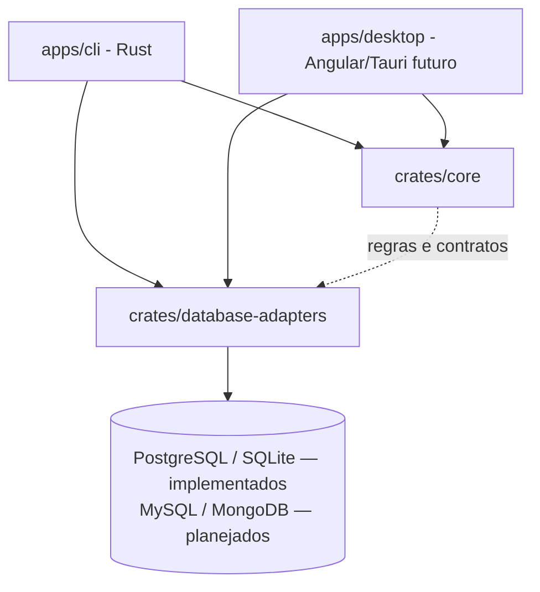

# Arquitetura

- CLI e Tauri são interfaces do mesmo sistema; as regras de backup não ficam no frontend.
- O domínio não deve depender de Clap, Tauri, bancos específicos ou infraestrutura Docker.
- Adaptadores lidam com capacidades específicas por SGBD, sem prometer uma função universal.
- `core/`, `shared/`, `features/` e `layout/` são pastas do frontend **quando ele for criado**.
- `crates/` Rust são compartilhadas entre interfaces. A pasta `libs/` TS não será criada sem uso.
- Segredos: `crates/core/src/secret.rs` define o contrato `SecretProvider`, de onde a senha veio
  (`SecretSource`) e a leitura estrita de arquivo de senha. A CLI implementa o contrato em
  `apps/cli/src/credentials.rs` (flag, variáveis, prompt). O desktop e um futuro adaptador de keyring
  entram como outras implementações. Ver [`configuracao.md`](configuracao.md#credenciais).
- `crates/database-adapters/src/postgres/tools.rs` executa `pg_dump`/`pg_restore` em modo `native`
  ou `docker`, sempre com argumentos estruturados e a senha num `.pgpass` temporário. O banco vai
  em `--dbname dbname='<nome escapado>'`: um valor de `--dbname` com `=` seria lido pelo libpq como
  string de conexão (host, porta, banco), então o nome nunca é repassado cru. No cancelamento, o
  cliente `docker run` é encerrado primeiro e o `docker rm --force` é repetido por até 2s. Isso cobre
  o caso em que o daemon termina de criar o container depois que o cliente morreu (container em
  estado "Created" não é removido pelo `--rm`).
  Distribuição nativa das ferramentas será avaliada por SO.
- `crates/storage` grava o backup localmente: arquivo `.partial`, SHA-256 em streaming,
  `fsync` e `rename` atômico, além do manifesto versionado `.meta.json` ([`manifesto.md`](manifesto.md)). Destinos em nuvem entram nessa crate.
- O comando `backup run` da CLI monta as peças: conexão → runner → storage → histórico.
- O comando `restore run` faz o caminho inverso: checksum (storage/histórico) → `pg_restore --list` →
  estado do destino (`postgres/admin.rs`) → `pg_restore` em um banco novo ou temporário → troca de nomes.
- `crates/core/src/engine.rs` define o `DatabaseEngine` (`postgres`, `sqlite`). Os nomes são os
  mesmos do `CHECK` da tabela `connections` do histórico e do campo `engine` do manifesto v2. O
  legado `postgresql` (manifesto v1) é lido como `postgres`. MySQL e MongoDB entram com seus cards.
- `crates/database-adapters/src/sqlite.rs` faz backup e restore de SQLite com a Online Backup API do
  `rusqlite`, sem ferramenta externa:
  - a origem é aberta só para leitura e precisa ser um arquivo regular com o cabeçalho
    `SQLite format 3`;
  - o destino é sempre um `.partial` já criado (`0600`), aberto sem `CREATE`, com
    `journal_mode=OFF` durante a cópia (não gera `-journal`) e `DELETE` no fim. Sem isso, uma origem
    WAL deixaria o artefato marcado como WAL, e abrir o artefato criaria `-wal`/`-shm`;
  - a cópia anda em passos de 256 páginas, com cancelamento entre os passos. Se outra conexão gravar
    entre dois passos, o SQLite reinicia a cópia; na primeira reinicialização detectada, o restante
    vai num passo só (snapshot consistente), para um escritor contínuo não impedir o fim (livelock).
    Em WAL esse passo não bloqueia escritores; em modo rollback, eles esperam até o fim da cópia;
  - `inspect_backup` roda `PRAGMA integrity_check` e conta objetos e tabelas;
  - `check_not_in_use` recusa um destino de `--overwrite` aberto por outro processo: tenta
    `BEGIN EXCLUSIVE` sem espera e, no Linux, procura o `(dev, inode)` do arquivo em `/proc/<pid>/fd`.
- Todo `.partial` (dump, manifesto e destino de restore SQLite) fica com um lock exclusivo
  (`File::try_lock`, `flock` no Unix) enquanto está em uso. Como o SO solta o lock quando o
  processo morre, `LocalTarget::remove_orphan_partials` consegue distinguir um órfão de um backup
  em andamento sem adivinhar.
- O histórico interno (`crates/history`) também é SQLite, mas é outro arquivo: a CLI recusa usá-lo
  como origem ou destino de backup e restore.
- Agendamento invoca a CLI com mecanismo independente da janela desktop, não incluído no MVP.

## Organização da CLI

`apps/cli/src/` é só a interface. A lógica continua nas crates.

| Arquivo | Papel |
| --- | --- |
| `main.rs` | Árvore de comandos (`connection test`, `backup run/list/verify`, `restore run/list`), opções globais `--json`/`--log-level`, leitura de senha e mapeamento de erros para exit codes. |
| `output.rs` | Único ponto de saída. `success` imprime o texto ou `{"status":"ok",...}`; `fail` escreve `Erro: ...` no stderr e, com `--json`, `{"status":"error","code":N,"error":"..."}` no stdout. Também configura o `tracing`. |
| `archive.rs` | Validações de arquivo compartilhadas por `restore run` e `backup verify`: SGBD do arquivo, checksum contra `.meta.json`/histórico, leitura com `pg_restore --list` e compatibilidade de versões. |
| `backup.rs`, `restore.rs`, `verify.rs`, `listing.rs` | Um comando (ou par de `list`) por arquivo. `backup.rs` e `restore.rs` escolhem o fluxo pelo `--engine`. |
| `sqlite.rs` | Fluxos de backup e restore do SQLite: chama o adaptador em `spawn_blocking`, repassa Ctrl+C e `--timeout` pela flag de cancelamento e publica o resultado com o storage e o histórico. |

Regras da saída:

- **stdout** só recebe o resultado (texto ou uma linha JSON), para ser seguro em scripts.
- **stderr** recebe erros e logs do `tracing`. Os logs têm horário, `operation` (`backup.run`,
  `restore.run`, `backup.verify`, `connection.test`), IDs de execução, `status` e `duration_ms`, sem senha,
  `secret_ref` ou conteúdo do dump. Cores ANSI só quando o stderr é um terminal.
- **Nível dos logs:** `--log-level` > `RUST_LOG` > `warn`. O nível vale para a CLI; as dependências
  ficam em `warn`.

`backup verify` precisa escolher um `pg_restore` compatível sem conectar a um servidor. Ele usa a
versão do PostgreSQL de origem gravada no manifesto (`.meta.json`) ou, na falta dele, a versão
registrada no histórico. Sem nenhuma das duas, o arquivo é recusado (código 10). Com o manifesto,
verify e restore não dependem do histórico SQLite. As checagens estão em [`manifesto.md`](manifesto.md).
Para SQLite não há versão de ferramenta a escolher: o `verify` usa o `integrity_check` do próprio
`rusqlite`.

## Fluxo alvo de backup

Antes de operar em produção: implementar autenticação segura, erros sanitizados, consistência,
verificação de integridade, confirmação de restore destrutivo, limites de recursos e testes reais.
