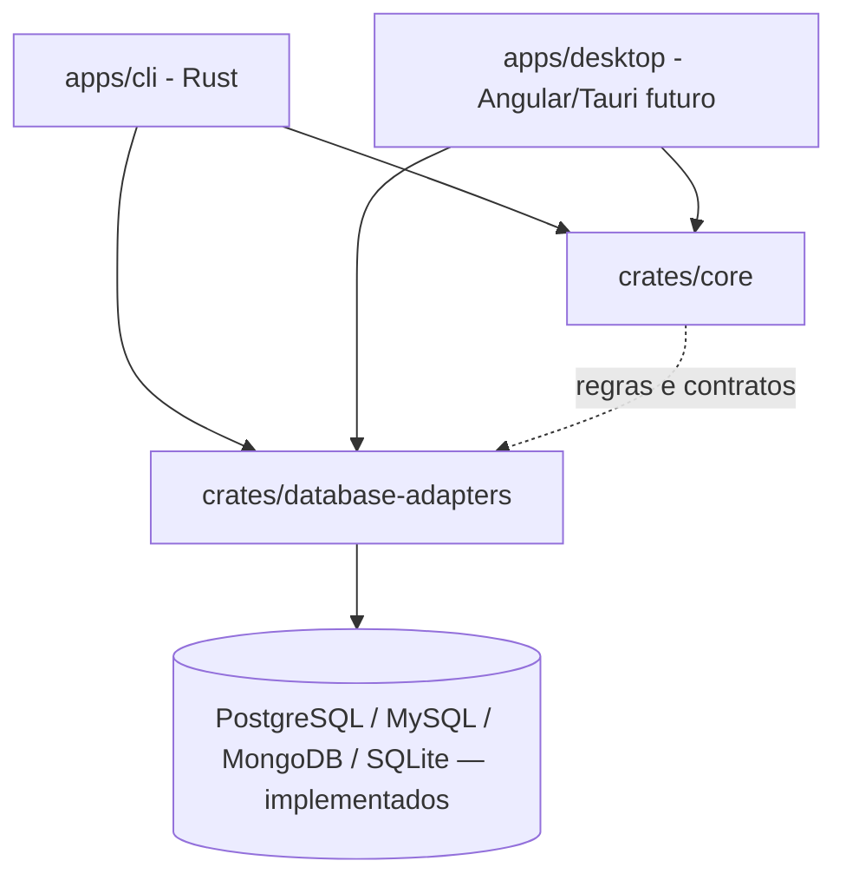
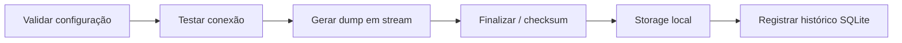

# Arquitetura

- CLI e Tauri são interfaces do mesmo sistema; as regras de backup não ficam no frontend.
- O domínio não deve depender de Clap, Tauri, bancos específicos ou infraestrutura Docker.
- Adaptadores lidam com capacidades específicas por SGBD, sem prometer uma função universal. O que
  cada um suporta fica tipado em `crates/core/src/capability.rs` (`Operation`, `Support`,
  `DatabaseEngine::capabilities`). A CLI mostra essa matriz em `engines` e tira dela as mensagens de
  operação não disponível. Ver [`capacidades.md`](capacidades.md).
- `core/`, `shared/`, `features/` e `layout/` são pastas do frontend **quando ele for criado**.
- `crates/` Rust são compartilhadas entre interfaces. A pasta `libs/` TS não será criada sem uso.
- Segredos: `crates/core/src/secret.rs` define o contrato `SecretProvider`, de onde a senha veio
  (`SecretSource`) e a leitura estrita de arquivo de senha. A CLI implementa o contrato em
  `apps/cli/src/credentials.rs` (flag, variáveis, prompt). O desktop e um futuro adaptador de keyring
  entram como outras implementações. Ver [`configuracao.md`](configuracao.md#credenciais).
- `crates/database-adapters/src/postgres/tools.rs` executa `pg_dump`/`pg_restore` em modo `native`
  ou `docker`, sempre com argumentos estruturados e a senha num `.pgpass` temporário. O banco vai
  em `--dbname dbname='<nome escapado>'`: um valor de `--dbname` com `=` seria lido pelo libpq como
  string de conexão (host, porta, banco), então o nome nunca é repassado cru. No cancelamento, o
  cliente `docker run` é encerrado primeiro e o `docker rm --force` é repetido por até 2s. Isso cobre
  o caso em que o daemon termina de criar o container depois que o cliente morreu (container em
  estado "Created" não é removido pelo `--rm`).
  Distribuição nativa das ferramentas será avaliada por SO.
- `crates/database-adapters/src/process.rs` é o runner comum de ferramentas externas (PostgreSQL,
  MySQL e MongoDB): `RunnerChoice`/`RunnerKind`, `ToolError`, o `ToolProcess` com stderr limitado a
  8 KiB e sanitizado, cancelamento com `docker rm --force` repetido, o diretório temporário de
  credenciais (`0600`, apagado junto com o processo) e a busca do pacote de certificados do sistema.
  Os adaptadores só montam os argumentos de cada ferramenta.
- `crates/database-adapters/src/mysql/` segue o mesmo desenho do PostgreSQL:
  - `connection.rs` testa a conexão com `mysql_async` (TLS via rustls com os certificados do
    sistema; as raízes embutidas da `webpki-roots` ficam desligadas) e classifica os erros nos
    mesmos `ConnectionError` do PostgreSQL (1045/1044 → autenticação, 1049 → banco inexistente);
  - `admin.rs` consulta `information_schema` (existência do banco, tabelas, tabelas fora do InnoDB)
    e cria/apaga bancos com identificadores entre crases;
  - `tools.rs` roda `mysqldump`/`mysql` em `native` ou `docker` (imagem `mysql:<major.minor>`), com
    `--defaults-extra-file` como primeiro argumento, `--protocol=TCP` (em `localhost` o cliente
    usaria o socket Unix) e o nome do banco depois de `--` no `mysqldump`, para um nome que começa
    com `-` não virar opção. O restore usa `--binary-mode` e `--local-infile=0`;
  - `dump.rs` lê o dump SQL em streaming, guardando só os primeiros 256 bytes de cada linha:
    cabeçalho do `mysqldump`, banco, versões, contagem de tabelas/views/triggers/rotinas/eventos,
    linha final `-- Dump completed` e recusa de `USE`/`CREATE DATABASE`/`DROP DATABASE`.
- `crates/database-adapters/src/mongo/` segue o mesmo desenho (o módulo se chama `mongo` porque
  `mongodb` colidiria com o nome do crate externo):
  - `connection.rs` testa a conexão com o driver oficial `mongodb` (rustls com o pacote de
    certificados do sistema em `ca_file_path`, sem as raízes embutidas; conexão direta a um único
    host, sem `mongodb+srv` nem descoberta de membros). Antes do driver há uma sondagem TCP, porque o
    driver devolve falhas de conexão como `ServerSelection` com texto livre. Lê o `hello` (topologia:
    standalone, replica set com primário ou não, sharded) e o `buildInfo` (versão), e classifica os
    erros nos mesmos `ConnectionError` dos outros SGBDs (autenticação, banco inexistente, TLS,
    inacessível, tempo esgotado);
  - `admin.rs` consulta `listCollections` (existência do banco, coleções, views, contagem de documentos
    por coleção) e apaga bancos. Cada chamada abre e fecha o próprio cliente;
  - `tools.rs` roda `mongodump`/`mongorestore` em `native` ou `docker` (imagem
    `mongo:<major.minor>`). A senha vai num arquivo YAML `0600` (`password: "..."`) passado com
    `--config=`, que é sempre o primeiro argumento; nunca por argumento nem por variável de ambiente.
    O dump é de um banco (`--db`) em `--archive`, no stdout. O restore lê o archive do stdin com
    `--nsInclude/--nsFrom/--nsTo`, `--stopOnError` e `--bypassDocumentValidation`, e nunca usa
    `--drop`. A tabela de compatibilidade entre a versão do servidor e a das ferramentas fica em
    [`stack.md`](stack.md);
  - `archive.rs` lê o archive em streaming, sem restaurar (ver "MongoDB: formato do archive" abaixo).
- `crates/storage` grava o backup localmente: arquivo `.partial`, SHA-256 em streaming,
  `fsync` e `rename` atômico, além do manifesto versionado `.meta.json` ([`manifesto.md`](manifesto.md)). Destinos em nuvem entram nessa crate.
- O comando `backup run` da CLI monta as peças: conexão → runner → storage → histórico.
- O comando `restore run` faz o caminho inverso: checksum (storage/histórico) → `pg_restore --list` →
  estado do destino (`postgres/admin.rs`) → `pg_restore` em um banco novo ou temporário → troca de nomes.
- `crates/core/src/engine.rs` define o `DatabaseEngine` (`postgres`, `mysql`, `mongodb`, `sqlite`). Os
  nomes são os mesmos do `CHECK` da tabela `connections` do histórico e do campo `engine` do manifesto
  v2. O legado `postgresql` (manifesto v1) é lido como `postgres`.
- `crates/core/src/connection.rs` tem um tipo de configuração por servidor
  (`PostgresConnectionConfig`, `MysqlConnectionConfig`, `MongoConnectionConfig`) com a mesma regra de
  TLS (sem TLS só em `localhost`) e os limites de nome de cada SGBD. No MongoDB o nome do banco não
  pode ter `/ \ . espaço " $ * < > : | ?` nem nulo (a regra mais restrita do servidor, que também
  elimina os metacaracteres dos padrões `--nsInclude`/`--nsFrom`), nem ser `admin`, `local` ou
  `config`, e o host é um só (sem lista de hosts nem nome de replica set). O `SecretProvider` recebe só o destino exibível
  (`&dyn Display`), e a CLI escolhe as variáveis de ambiente pelo SGBD.
- `crates/database-adapters/src/sqlite.rs` faz backup e restore de SQLite com a Online Backup API do
  `rusqlite`, sem ferramenta externa:
  - a origem é aberta só para leitura e precisa ser um arquivo regular com o cabeçalho
    `SQLite format 3`;
  - o destino é sempre um `.partial` já criado (`0600`), aberto sem `CREATE`, com
    `journal_mode=OFF` durante a cópia (não gera `-journal`) e `DELETE` no fim. Sem isso, uma origem
    WAL deixaria o artefato marcado como WAL, e abrir o artefato criaria `-wal`/`-shm`;
  - a cópia anda em passos de 256 páginas, com cancelamento entre os passos. Se outra conexão gravar
    entre dois passos, o SQLite reinicia a cópia; na primeira reinicialização detectada, o restante
    vai num passo só (snapshot consistente), para um escritor contínuo não impedir o fim (livelock).
    Em WAL esse passo não bloqueia escritores; em modo rollback, eles esperam até o fim da cópia;
  - `inspect_backup` roda `PRAGMA integrity_check` e conta objetos e tabelas;
  - `check_not_in_use` recusa um destino de `--overwrite` aberto por outro processo: tenta
    `BEGIN EXCLUSIVE` sem espera e, no Linux, procura o `(dev, inode)` do arquivo em `/proc/<pid>/fd`.
- Todo `.partial` (dump, manifesto e destino de restore SQLite) fica com um lock exclusivo
  (`File::try_lock`, `flock` no Unix) enquanto está em uso. Como o SO solta o lock quando o
  processo morre, `LocalTarget::remove_orphan_partials` consegue distinguir um órfão de um backup
  em andamento sem adivinhar.
- O histórico interno (`crates/history`) também é SQLite, mas é outro arquivo: a CLI recusa usá-lo
  como origem ou destino de backup e restore.
- Agendamento invoca a CLI com mecanismo independente da janela desktop, não incluído no MVP.

## Organização da CLI

`apps/cli/src/` é só a interface. A lógica continua nas crates.

| Arquivo | Papel |
| --- | --- |
| `main.rs` | Árvore de comandos (`connection test`, `backup run/list/verify`, `restore run/list`, `engines`), opções globais `--json`/`--log-level`, leitura de senha, mapeamento de erros para exit codes e o helper `unsupported`, que recusa com código 2 uma operação fora da matriz de capacidades. |
| `engines.rs` | Comando `engines`: imprime a matriz de `DatabaseEngine::capabilities` em texto ou JSON. |
| `output.rs` | Único ponto de saída. `success` imprime o texto ou `{"status":"ok",...}`; `fail` escreve `Erro: ...` no stderr e, com `--json`, `{"status":"error","code":N,"error":"..."}` no stdout. Também configura o `tracing`. |
| `archive.rs` | Validações de arquivo compartilhadas por `restore run` e `backup verify`: SGBD do arquivo, checksum contra `.meta.json`/histórico, leitura com `pg_restore --list` e compatibilidade de versões. |
| `backup.rs`, `restore.rs`, `verify.rs`, `listing.rs` | Um comando (ou par de `list`) por arquivo. `backup.rs` e `restore.rs` escolhem o fluxo pelo `--engine`. |
| `mongo.rs` | Fluxos do MongoDB: valida a topologia (recusa sharded e secundário), roda o `mongodump`, confere o archive antes de publicar e, no restore, só cria bancos novos, compara a contagem de documentos de cada coleção com a do archive e apaga o banco criado em falha ou cancelamento. |
| `sqlite.rs` | Fluxos de backup e restore do SQLite: chama o adaptador em `spawn_blocking`, repassa Ctrl+C e `--timeout` pela flag de cancelamento e publica o resultado com o storage e o histórico. |

Regras da saída:

- **stdout** só recebe o resultado (texto ou uma linha JSON), para ser seguro em scripts.
- **stderr** recebe erros e logs do `tracing`. Os logs têm horário, `operation` (`backup.run`,
  `restore.run`, `backup.verify`, `connection.test`), IDs de execução, `status` e `duration_ms`, sem senha,
  `secret_ref` ou conteúdo do dump. Cores ANSI só quando o stderr é um terminal.
- **Nível dos logs:** `--log-level` > `RUST_LOG` > `warn`. O nível vale para a CLI; as dependências
  ficam em `warn`.

`backup verify` precisa escolher um `pg_restore` compatível sem conectar a um servidor. Ele usa a
versão do PostgreSQL de origem gravada no manifesto (`.meta.json`) ou, na falta dele, a versão
registrada no histórico. Sem nenhuma das duas, o arquivo é recusado (código 10). Com o manifesto,
verify e restore não dependem do histórico SQLite. As checagens estão em [`manifesto.md`](manifesto.md).
Para SQLite não há versão de ferramenta a escolher: o `verify` usa o `integrity_check` do próprio
`rusqlite`. Para MySQL também não: o dump é SQL puro e o `verify` o lê em Rust (`mysql/dump.rs`),
sem `mysql` nem Docker. O mesmo vale para MongoDB: o `verify` lê o archive em Rust
(`mongo/archive.rs`), sem `mongodump`, `mongorestore` nem Docker.

O restore MySQL não tem troca atômica: o MySQL não tem `RENAME DATABASE`, e um `RENAME TABLE` não
leva views, rotinas nem triggers. Por isso ele só cria um banco novo (`apps/cli/src/mysql.rs`):
confere que o destino não existe, cria, aplica o dump, compara a contagem de tabelas com o dump e,
em falha ou cancelamento, apaga só o banco que ele mesmo criou.

O restore MongoDB também não tem troca atômica: não existe `RENAME DATABASE`, nem um `CREATE DATABASE`
que falhe quando o banco já existe (o banco nasce na primeira escrita). Por isso ele só cria um banco
novo (`apps/cli/src/mongo.rs`): confere que o destino não tem nenhuma coleção, restaura o archive
com o `mongorestore` (renomeando só o banco de origem, com `--nsInclude/--nsFrom/--nsTo`), compara a
contagem de documentos de cada coleção e a lista de views do destino com as do archive e, em falha ou
cancelamento, apaga o banco inteiro. Entre a checagem e a primeira escrita há uma janela em que outro
cliente poderia criar o mesmo banco (ver `seguranca.md`).

## MongoDB: topologia e consistência

O backup é sempre de **um banco**, com `mongodump --db=<banco> --archive`, sem `--oplog` em
qualquer topologia. O `--oplog` é o único mecanismo do `mongodump` para um instantâneo de um único
instante, e o spike do DB-21 confirmou que ele só vale no dump do servidor inteiro, de um replica
set: com `--db`, o `mongodump` sai com `bad option: --oplog mode only supported on full dumps`; num
standalone, o dump do servidor inteiro com `--oplog` também falha (não há oplog). O backup do servidor
inteiro com `--oplog` fica para um card futuro.

| Topologia | Backup | Restore | Consistência do backup |
| --- | --- | --- | --- |
| Standalone | aceito | aceito | Cada coleção é lida por uma consulta própria, em paralelo (até 4). Escritas durante o backup podem deixar coleções inconsistentes entre si, e até uma coleção sem o estado de um único instante. |
| Replica set, primário | aceito | aceito | A mesma do standalone. O mecanismo de instantâneo (`--oplog`) existe, mas só para o servidor inteiro. |
| Replica set, secundário ou árbitro | recusado (código 2) | recusado (código 2) | Não testado, e ler de um secundário traz atraso de replicação. |
| Cluster sharded (`mongos`) | recusado (código 2) | recusado (código 2) | Não testado. O `--oplog` também não funciona em sharded. |

- A CLI avisa em todo `backup run`, no log (`warn`) e no texto do resultado: "o backup de um banco
  MongoDB não é um snapshot de um único instante". Para um backup consistente, pare as escritas
  durante o backup ou use um banco quieto (por exemplo, um secundário isolado ou um snapshot do
  volume, fora do alcance desta ferramenta).
- A topologia vem do `hello` do servidor e fica no manifesto (`topology`: `standalone`,
  `replica_set` ou `sharded`) e no JSON do `connection test` e do `backup run`.
- A conexão é direta ao host informado, e as ferramentas também: o spike confirmou, com um servidor
  "isca" em `127.0.0.1:27017` e um replica set anunciando `127.0.0.1:27017`, que o `mongodump`
  conecta ao host e à porta informados, sem descobrir os membros.
- Servidor com versão abaixo de 4.4 é recusado (código 1). Só uma versão de servidor é testada
  automaticamente; ver [`testes.md`](testes.md).

### MongoDB: formato do archive

O arquivo gerado é o `--archive` do `mongodump`, sem compressão (o `--gzip` exigiria descomprimir no
`verify` e conflita com a compressão transversal prevista). Layout confirmado no spike (ferramentas
`100.10.0` e `100.19.1`):

1. número mágico de 4 bytes `6d e2 99 81`;
2. documento BSON de cabeçalho: `concurrent_collections`, `version` (`0.1`), `server_version` e
   `tool_version`;
3. prelúdio: um documento por coleção ou view (`db`, `collection`, `metadata`, `size` e `type`, que
   vale `collection` ou `view`), terminado por `0xFFFFFFFF`;
4. corpo: blocos `{db, collection, EOF, CRC}` seguidos dos documentos e de um terminador
   `0xFFFFFFFF`. Cada coleção, **inclusive views e coleções vazias**, recebe um bloco com
   `EOF: true` (o `mongorestore` usa esse bloco vazio para criar a view).

O `verify` e o `backup run` leem o arquivo em streaming, sem guardar documentos: cada documento de
dados é contado e pulado, e o tamanho declarado de qualquer documento tem de estar entre 5 bytes e
16 MiB + 16 KiB, senão o arquivo é recusado antes de alocar. O arquivo é recusado quando:

- não começa com o número mágico (código 10 no `verify` e no `restore`);
- termina antes de uma coleção receber o `EOF` ("incompleto");
- tem blocos de uma coleção ausente do prelúdio, mais de um banco (backup do servidor inteiro) ou
  mais de 100 mil coleções ("corrompido");
- não tem coleções nem views;
- contém coleções time series (ver `seguranca.md`): o `mongodump` grava os dados delas no namespace
  `system.buckets.<nome>`, que não consta no prelúdio.

O CRC dos blocos não é conferido pelo `verify`: o SHA-256 do manifesto cobre a integridade do
arquivo, e o `mongorestore` confere o CRC de cada coleção ao final dela (o spike confirmou que um
byte trocado dentro de um valor faz o `mongorestore` falhar com `CRC mismatch`). A leitura confere
estrutura, não conteúdo: quem usa `--allow-unverified` depende desse CRC e da contagem de documentos
do restore.

## Fluxo alvo de backup

Antes de operar em produção: implementar autenticação segura, erros sanitizados, consistência,
verificação de integridade, confirmação de restore destrutivo, limites de recursos e testes reais.
