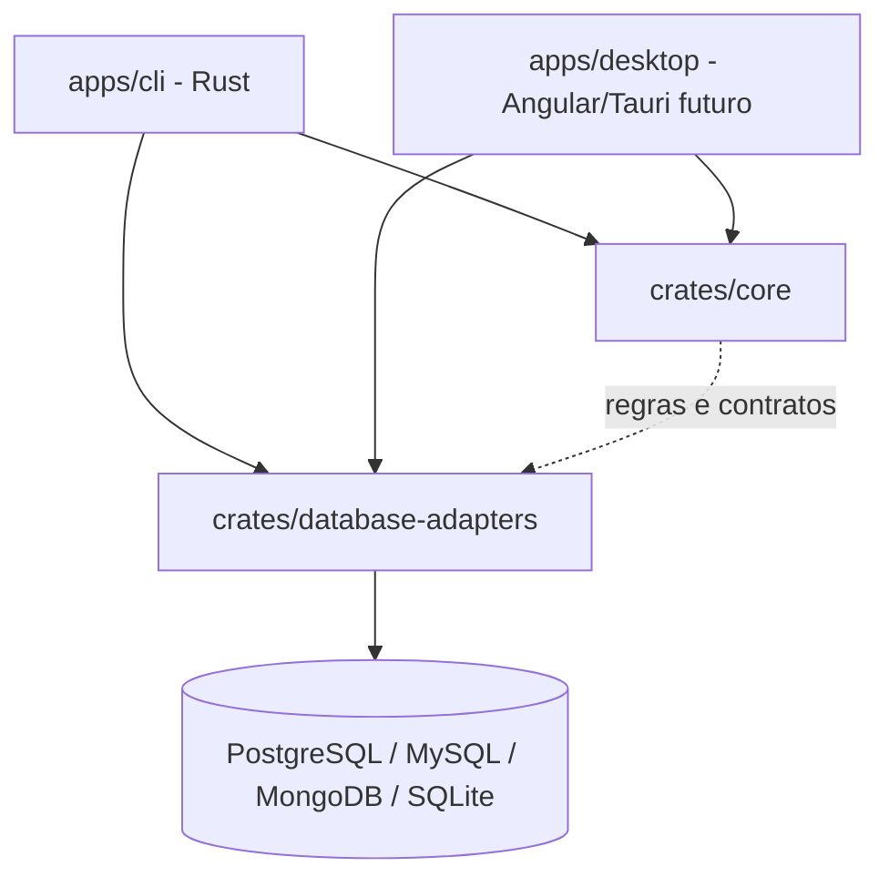
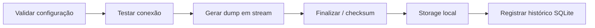

# Arquitetura

- CLI e Tauri são interfaces do mesmo sistema; as regras de backup não ficam no frontend.
- O domínio não deve depender de Clap, Tauri, bancos específicos ou infraestrutura Docker.
- Adaptadores lidam com capacidades específicas por SGBD, sem prometer uma função universal.
- `core/`, `shared/`, `features/` e `layout/` são pastas do frontend **quando ele for criado**.
- `crates/` Rust são compartilhadas entre interfaces. A pasta `libs/` TS não será criada sem uso.
- Modo Docker é para desenvolvimento e um executor opcional; distribuição nativa será avaliada por SO.
- SQLite interno será usado para histórico; não confundir com suporte futuro a backup de bancos SQLite.
- Agendamento invoca a CLI com mecanismo independente da janela desktop, não incluído no MVP.

## Fluxo alvo de backup

Antes de operar em produção: implementar autenticação segura, erros sanitizados, consistência,
verificação de integridade, confirmação de restore destrutivo, limites de recursos e testes reais.
