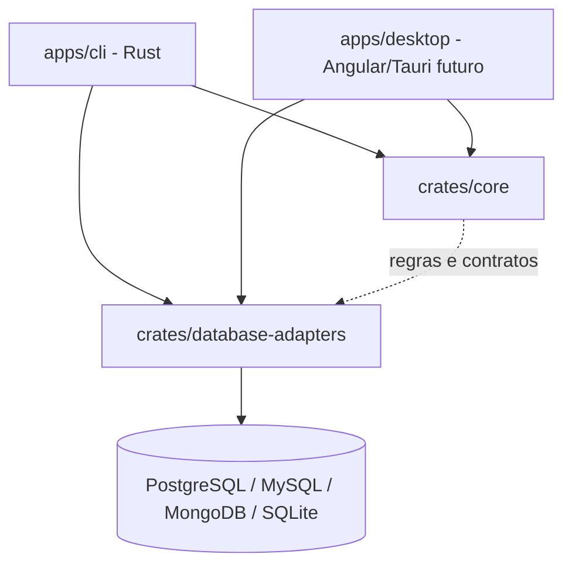
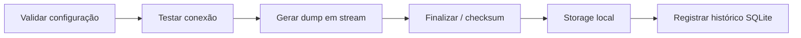

# Arquitetura

- CLI e Tauri são interfaces do mesmo sistema; as regras de backup não ficam no frontend.
- O domínio não deve depender de Clap, Tauri, bancos específicos ou infraestrutura Docker.
- Adaptadores lidam com capacidades específicas por SGBD, sem prometer uma função universal.
- `core/`, `shared/`, `features/` e `layout/` são pastas do frontend **quando ele for criado**.
- `crates/` Rust são compartilhadas entre interfaces. A pasta `libs/` TS não será criada sem uso.
- `crates/database-adapters/src/postgres/tools.rs` executa `pg_dump`/`pg_restore` em modo `native`
  ou `docker`, sempre com argumentos estruturados e a senha num `.pgpass` temporário. O banco vai
  em `--dbname dbname='<nome escapado>'`: um valor de `--dbname` com `=` seria lido pelo libpq como
  string de conexão (host, porta, banco), então o nome nunca é repassado cru. No cancelamento, o
  cliente `docker run` é encerrado primeiro e o `docker rm --force` é repetido por até 2s. Isso cobre
  o caso em que o daemon termina de criar o container depois que o cliente morreu (container em
  estado "Created" não é removido pelo `--rm`).
  Distribuição nativa das ferramentas será avaliada por SO.
- `crates/storage` grava o backup localmente: arquivo `.partial`, SHA-256 em streaming,
  `fsync` e `rename` atômico, além do arquivo `.meta.json`. Destinos em nuvem entram nessa crate.
- O comando `backup run` da CLI monta as peças: conexão → runner → storage → histórico.
- O comando `restore run` faz o caminho inverso: checksum (storage/histórico) → `pg_restore --list` →
  estado do destino (`postgres/admin.rs`) → `pg_restore` em um banco novo ou temporário → troca de nomes.
- SQLite interno será usado para histórico; não confundir com suporte futuro a backup de bancos SQLite.
- Agendamento invoca a CLI com mecanismo independente da janela desktop, não incluído no MVP.

## Organização da CLI

`apps/cli/src/` é só a interface. A lógica continua nas crates.

| Arquivo | Papel |
| --- | --- |
| `main.rs` | Árvore de comandos (`connection test`, `backup run/list/verify`, `restore run/list`), opções globais `--json`/`--log-level`, leitura de senha e mapeamento de erros para exit codes. |
| `output.rs` | Único ponto de saída. `success` imprime o texto ou `{"status":"ok",...}`; `fail` escreve `Erro: ...` no stderr e, com `--json`, `{"status":"error","code":N,"error":"..."}` no stdout. Também configura o `tracing`. |
| `archive.rs` | Validações de arquivo compartilhadas por `restore run` e `backup verify`: checksum contra `.meta.json`/histórico, leitura com `pg_restore --list` e compatibilidade de versões. |
| `backup.rs`, `restore.rs`, `verify.rs`, `listing.rs` | Um comando (ou par de `list`) por arquivo. |

Regras da saída:

- **stdout** só recebe o resultado (texto ou uma linha JSON), para ser seguro em scripts.
- **stderr** recebe erros e logs do `tracing`. Os logs têm horário, `operation` (`backup.run`,
  `restore.run`, `backup.verify`, `connection.test`), IDs de execução, `status` e `duration_ms`, sem senha,
  `secret_ref` ou conteúdo do dump. Cores ANSI só quando o stderr é um terminal.
- **Nível dos logs:** `--log-level` > `RUST_LOG` > `warn`. O nível vale para a CLI; as dependências
  ficam em `warn`.

`backup verify` precisa escolher um `pg_restore` compatível sem conectar a um servidor. Ele usa a
versão do PostgreSQL de origem gravada no `.meta.json` ou, na falta dele, a versão registrada no
histórico. Sem nenhuma das duas, o arquivo é recusado (código 10). O manifesto versionado do DB-19 vai
substituir essa fonte.

## Fluxo alvo de backup

Antes de operar em produção: implementar autenticação segura, erros sanitizados, consistência,
verificação de integridade, confirmação de restore destrutivo, limites de recursos e testes reais.
