# Modelo do histórico interno

Schema aplicado pelas migrations `crates/history/migrations/0001_initial.sql`, `0002_restores.sql` e
`0003_restore_checksum_verified.sql`. Datas em UTC no formato RFC 3339 e IDs UUID v7.

```mermaid
erDiagram
    CONNECTIONS ||--o{ BACKUP_JOBS : possui
    BACKUP_JOBS ||--o{ BACKUP_EXECUTIONS : executa
    BACKUP_EXECUTIONS ||--o{ BACKUP_ARTIFACTS : gera
    BACKUP_ARTIFACTS |o--o{ RESTORE_EXECUTIONS : restaurado_em
    CONNECTIONS {
        text id PK
        text display_name UK
        text engine
        text host
        integer port
        text database_name
        text username
        text secret_ref
        text created_at
        text updated_at
    }
    BACKUP_JOBS {
        text id PK
        text connection_id FK
        text name
        text backup_type
        text created_at
    }
    BACKUP_EXECUTIONS {
        text id PK
        text job_id FK
        text status
        text started_at
        text finished_at
        integer duration_ms
        text error_message
    }
    BACKUP_ARTIFACTS {
        text id PK
        text execution_id FK
        text location
        text format
        integer size_bytes
        text checksum_sha256
        text tool_version
        text created_at
    }
    RESTORE_EXECUTIONS {
        text id PK
        text artifact_id FK
        text source_location
        text source_sha256
        integer checksum_verified
        text target_host
        integer target_port
        text target_database
        text mode
        text previous_database
        text status
        text started_at
        text finished_at
        integer duration_ms
        text error_message
    }
```

| Tabela | Guarda |
| --- | --- |
| `connections` | Dados não sensíveis da conexão. `secret_ref` aponta para onde a senha está (ex.: `env:DBU_PG_PASSWORD`), nunca a senha. |
| `backup_jobs` | Definição de um backup de uma conexão. Por enquanto só `full`. |
| `backup_executions` | Cada execução: `running`, `succeeded`, `failed` ou `canceled`, com duração e erro já sanitizado. |
| `backup_artifacts` | Arquivos gerados: local, formato, tamanho, SHA-256 e versão da ferramenta. |
| `restore_executions` | Cada restore: arquivo de origem (e o artefato, quando conhecido), se o checksum foi conferido com uma referência (`checksum_verified = 0` quando veio de `--allow-unverified`), destino sem senha, modo `create`/`overwrite`, banco anterior mantido, status, duração e erro saneado. |

- Tabelas `STRICT`, chaves estrangeiras ativas e `ON DELETE CASCADE`.
- Nenhuma coluna guarda senha ou token; um teste verifica isso.
- `schedules` entra quando o agendamento for implementado.
- Para identificar um artefato sem o histórico, o backup (DB-10) vai gravar um arquivo de metadados ao lado do dump.
