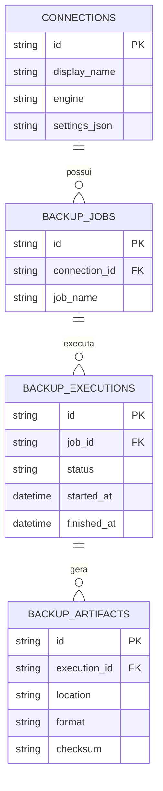

# Modelo do histórico interno (proposta)

> **Ainda não implementado**. A issue DB-8 definirá o esquema real e as migrações SQLite.

- Credenciais de bancos **não** serão armazenadas em texto puro no histórico.
- Schedules e delivery logs serão adicionados somente quando usados por funcionalidades reais.
